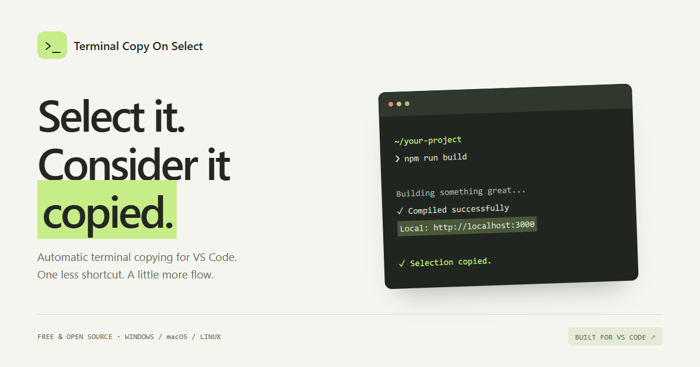

# Terminal Copy On Select for VS Code

**Select terminal text. Paste anywhere. Keep your flow.**

Automatically copy selected text from the VS Code integrated terminal to your clipboard. A small, free, open-source extension for copying build logs, error messages, file paths, and commands on Windows, macOS, and Linux.

[](https://marketplace.visualstudio.com/items?itemName=HoutanRocky.terminal-copy-on-select)
[](https://github.com/houtanrocky/vscode-extension-terminalcopyonselect/actions/workflows/ci.yml)
[](LICENSE.md)

[](https://houtanrocky.github.io/vscode-extension-terminalcopyonselect/)

[Install for VS Code](https://marketplace.visualstudio.com/items?itemName=HoutanRocky.terminal-copy-on-select) · [Website](https://houtanrocky.github.io/vscode-extension-terminalcopyonselect/) · [Setup guide](https://houtanrocky.github.io/vscode-extension-terminalcopyonselect/guide/) · [Support](https://houtanrocky.github.io/vscode-extension-terminalcopyonselect/support/)

## How it works

1. Install **Terminal Copy On Select** by **HoutanRocky**.
2. Open **Terminal → New Terminal** in VS Code.
3. Select some terminal output, then paste it into your editor, an issue, or another app.

The extension enables VS Code's native `terminal.integrated.copyOnSelection` setting when you have not explicitly configured it. VS Code performs the copying. Existing User, Workspace, and Workspace Folder preferences are preserved, including an explicit `false`.

## Install

Find the extension in the [Visual Studio Marketplace](https://marketplace.visualstudio.com/items?itemName=HoutanRocky.terminal-copy-on-select), or run:

```sh
code --install-extension HoutanRocky.terminal-copy-on-select
```

Requires VS Code 1.97 or a compatible API version. There is currently no published Open VSX listing. For compatible editors such as VSCodium, [build a VSIX from source](CONTRIBUTING.md) and use **Extensions: Install from VSIX**.

## Why use it?

- Copy terminal output automatically without a separate copy action.
- Use your existing PowerShell, Command Prompt, bash, zsh, fish, or WSL terminal.
- Keep your keyboard shortcuts and explicit settings.
- Use a small extension with no runtime library dependencies, telemetry, or clipboard monitoring.
- Inspect the complete implementation in [src/index.ts](src/index.ts).

## Settings and turning it off

Open VS Code Settings and search for `terminal.integrated.copyOnSelection`, or add this to your User Settings JSON:

```json
{
  "terminal.integrated.copyOnSelection": true
}
```

To stop automatic copying, set it to `false`. The extension respects that explicit choice on future starts. **Disabling or uninstalling the extension does not reset the saved setting.**

You can enable this built-in setting manually without the extension. The extension is a convenience for discovering and enabling it, and including it in your extension setup.

## Command Palette controls

The next release adds these commands under **Terminal Copy On Select**; they are also available when running this source in an Extension Development Host:

| Command | Action |
| --- | --- |
| Enable Copy on Selection | Set the user preference to true. |
| Disable Copy on Selection | Set the user preference to false. |
| Open Settings | Open the exact native setting. |
| Get Help | Open the public support page. |

Enable and disable commands change the user preference. If a workspace or remote setting overrides it, the extension explains where to review the effective value.

## Troubleshooting

**Selections do not copy:** Check that `terminal.integrated.copyOnSelection` is true and review applicable Workspace or Remote overrides. If needed after installation, run **Developer: Reload Window**.

**Vim or tmux captures the mouse:** Consult [VS Code's selection guidance](https://code.visualstudio.com/docs/terminal/basics#_selection) for the appropriate modifier while dragging.

**Editor selections do not copy:** This extension affects the integrated terminal. Editor files, the Output panel, and the Debug Console are outside its scope.

Visit the [searchable support page](https://houtanrocky.github.io/vscode-extension-terminalcopyonselect/support/) for more answers, or [report a bug](https://github.com/houtanrocky/vscode-extension-terminalcopyonselect/issues/new?template=bug_report.yml).

## Privacy

The extension does not read terminal output or clipboard content, collect analytics, or make network requests. It configures a native VS Code setting. [Read the privacy explanation](https://houtanrocky.github.io/vscode-extension-terminalcopyonselect/privacy/).

## Development and contributing

Use Node.js 24 and pnpm 10.27.0:

```sh
pnpm install --frozen-lockfile
pnpm typecheck
pnpm lint
pnpm test
pnpm build
pnpm ext:package
```

For the GitHub Pages website:

```sh
pnpm site:check
pnpm site:preview
pnpm site:test
```

See [CONTRIBUTING.md](CONTRIBUTING.md) for browser checks and [docs/DISCOVERABILITY.md](docs/DISCOVERABILITY.md) for Pages deployment, search-engine submission, and release setup. Website deployment and Marketplace publication are separate. See [CHANGELOG.md](CHANGELOG.md) for pending extension changes.

## License

[MIT](LICENSE.md). Built by [Houtan Rocky](https://github.com/houtanrocky).

## Contributors ✨

Thanks goes to these wonderful people ([emoji key](https://allcontributors.org/docs/en/emoji-key)):

<!-- ALL-CONTRIBUTORS-LIST:START - Do not remove or modify this section -->
<!-- prettier-ignore-start -->
<!-- markdownlint-disable -->
<table>
  <tbody>
    <tr>
      <td align="center" valign="top" width="14.28%"><a href="https://github.com/qewr1324"><br /><sub><b>qewr1324</b></sub></a><br /><a href="https://github.com/houtanrocky/vscode-extension-terminalcopyonselect/commits?author=qewr1324" title="Documentation">📖</a> <a href="https://github.com/houtanrocky/vscode-extension-terminalcopyonselect/commits?author=qewr1324" title="Heart">❤️</a> <a href="#ideas-qewr1324" title="Design">🎨</a></td>
      <!-- بقیه مشارکت‌کنندگان اینجا قرار می‌گیرند -->
    </tr>
  </tbody>
</table>

<!-- markdownlint-restore -->
<!-- prettier-ignore-end -->
<!-- ALL-CONTRIBUTORS-LIST:END -->

This project follows the [all-contributors](https://github.com/all-contributors/all-contributors) specification. Contributions of any kind welcome!
